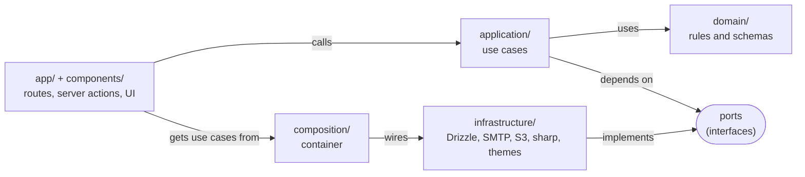
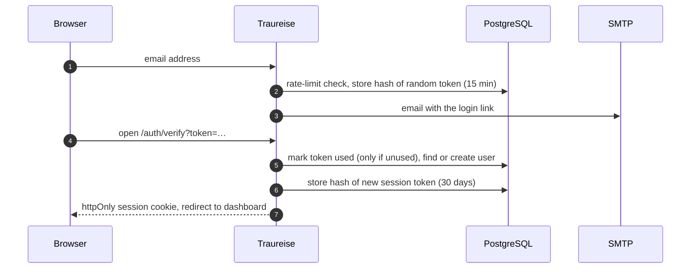

# Architecture

Traureise is a single Next.js application (App Router, TypeScript) with PostgreSQL. Its code is split
into layers whose dependencies only point inward, so business rules can be tested without a browser,
database or framework.

Arrows point from the code that knows to the code it knows about: the domain knows nothing else, and
only the composition root knows which adapter implements which port.

| Layer | Folder | Contains |
|---|---|---|
| Domain | `src/domain` | Pure rules and zod schemas: slugs, sections and item fields, ordering, calendar export, themes, fonts, uploads |
| Application | `src/application` | Use cases such as `RequestMagicLink`, `CreateWebsite`, `AddItem`, `MoveItem`, `DeleteWebsite`, and the ports they depend on |
| Infrastructure | `src/infrastructure` | Adapters: Drizzle repositories, SMTP mailer, local and S3 storage, sharp image processing, theme loader |
| Composition | `src/composition` | The container that wires adapters to ports |
| Web | `src/app`, `src/components` | Routes, server actions and UI. They only call use cases. |

ESLint enforces the direction: `src/domain` and `src/application` may not import infrastructure,
framework or UI code.

## Login flow

Only hashes of tokens are stored. Using a token is a single conditional update, so a link works exactly
once even when it is opened twice at the same moment.

## The editor preview is the public site

The editor's preview and the public page render the same `WeddingSite` component. Saving a form runs a
server action, which calls a use case and revalidates the editor route, so the preview updates with
exactly what guests will see. Hidden sections, and visible sections without content, are not
rendered.

## Data model

Every table holding user data cascades from `users.id`: deleting a user deletes their sessions,
websites, sections, items and upload records. Section items are one table with a `jsonb` column whose
shape is validated by the zod schemas in `src/domain/sections.ts`.

The reasoning behind these choices is recorded in the [design decisions](adr/0001-nextjs-with-layered-architecture.md).
