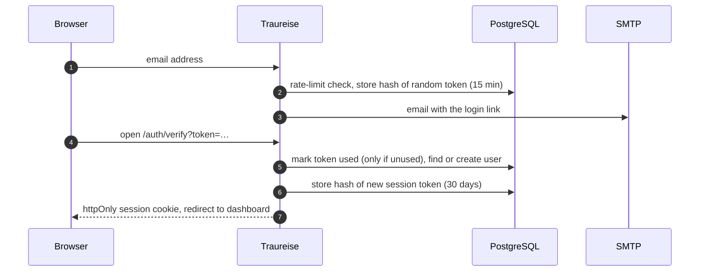

# Architecture

Traureise is a single Next.js application (App Router, TypeScript) with PostgreSQL. Its code is split
into layers whose dependencies only point inward, so business rules can be tested without a browser,
database or framework.

Arrows point from the code that knows to the code it knows about: the domain knows nothing else, and
only the composition root knows which adapter implements which port.

| Layer | Folder | Contains |
|---|---|---|
| Domain | `src/domain` | Pure rules and zod schemas: slugs, block types and the standard template, events, ordering, calendar export, themes, fonts, uploads |
| Application | `src/application` | Use cases such as `RequestMagicLink`, `CreateWebsite`, `AddItem`, `MoveItem`, `DeleteWebsite`, and the ports they depend on |
| Infrastructure | `src/infrastructure` | Adapters: Drizzle repositories, SMTP mailer, local and S3 storage, sharp image processing, theme loader |
| Composition | `src/composition` | The container that wires adapters to ports |
| Web | `src/app`, `src/components` | Routes, server actions and UI. They only call use cases. |

ESLint enforces the direction: `src/domain` and `src/application` may not import infrastructure,
framework or UI code.

## Login flow

Only hashes of tokens are stored. Using a token is a single conditional update, so a link works exactly
once even when it is opened twice at the same moment.

## The editor preview is the public site

The editor's preview and the public page render the same `WeddingSite` component. Saving a form runs a
server action, which calls a use case and revalidates the editor route, so the preview updates with
exactly what guests will see. A section renders its blocks in groups (consecutive blocks of one type form one
grid or list); hidden sections, and visible sections without content, are not rendered.

## Data model

Every table holding user data cascades from `users.id`: deleting a user deletes their sessions and
weddings. Everything a couple makes cascades from `weddings.id` ([ADR 0023](adr/0023-everything-belongs-to-the-wedding.md)):
website versions (`websites`, with their sections and blocks), the Ablauf (`wedding_events`), card versions,
the guest list, entitlements and upload records. Sections (`website_sections`) have an id and a position; their
blocks (`section_blocks`) are one table with a `jsonb` column whose shape is validated by the zod discriminated
union in `src/domain/sections.ts`. Event blocks reference `wedding_events` by id (`null` = all events) and never
copy them; deleting an event deletes the blocks pointing to it
([ADR 0025](adr/0025-sections-built-from-typed-blocks.md)).

The guest list (`rsvp_settings`, `rsvp_polls`, `households`, `guests`, `guest_requests`) cascades from
`weddings.id`. Households are found by the SHA-256 of their personal link's token, which is an HMAC of
the household id with `APP_SECRET` ([ADR 0015](adr/0015-households-with-hashed-personal-links.md)).
Retention and daily summaries run as `RunGuestJobs` on a timer started in `src/instrumentation.ts`
([ADR 0018](adr/0018-background-jobs-inside-the-app.md)).

Cards (`cards`, several versions per wedding and kind) cascade from `weddings.id`. `card_deliveries` (sent,
email claims and reminders per household and kind, whichever version went out), `card_opens` (opened, per
version) and `household_versions` (which version a household gets) cascade from the household, so retention
removes them with the guest list ([ADR 0024](adr/0024-versions-for-audiences.md)). One React component, `CardView`
(`src/components/cards/card-view.tsx`), draws a card from a `CardModel` (`src/domain/cards.ts`) on the
household page, in the editor's live preview, on the wedding's timeline, and through satori for the email image
and the PDF/PNG exports (`src/infrastructure/cards/renderer.tsx`, [ADR 0020](adr/0020-card-rendering-and-export.md)).
Card emails are queued in `card_deliveries` and sent by `RunMailJobs`, kicked after the request and run
with the guest jobs ([ADR 0021](adr/0021-sending-email-on-the-couples-behalf.md)).

The reasoning behind these choices is recorded in the [design decisions](adr/0001-nextjs-with-layered-architecture.md).
