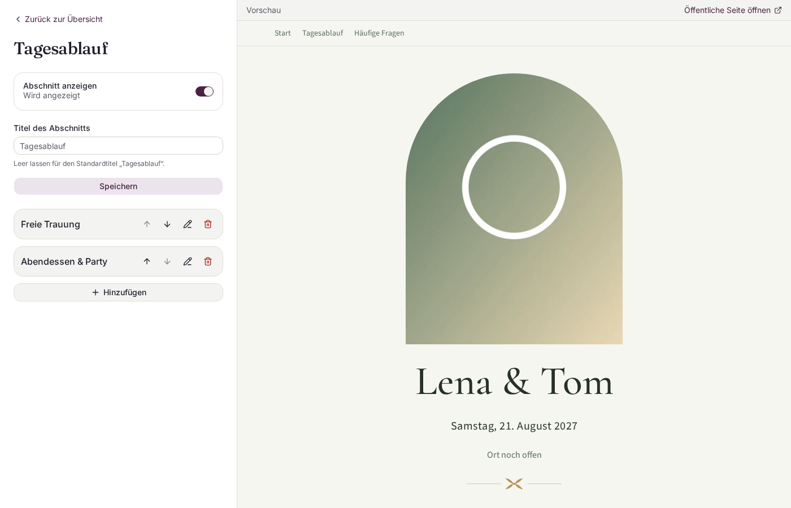
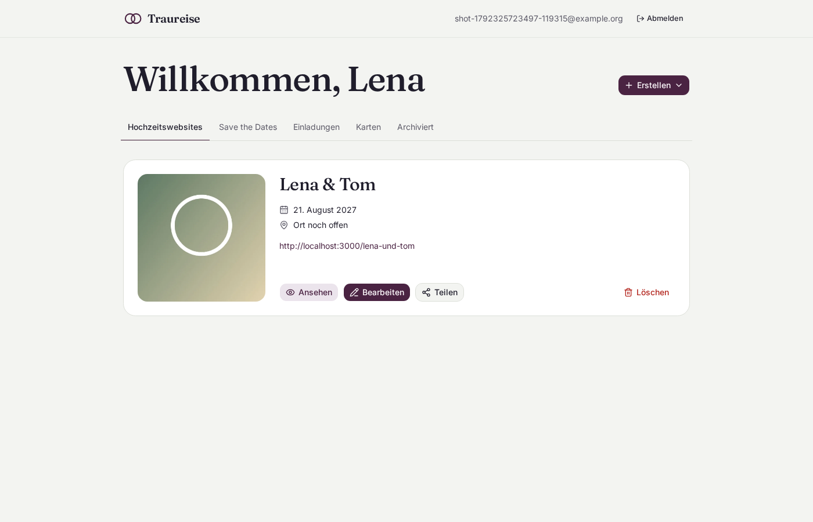
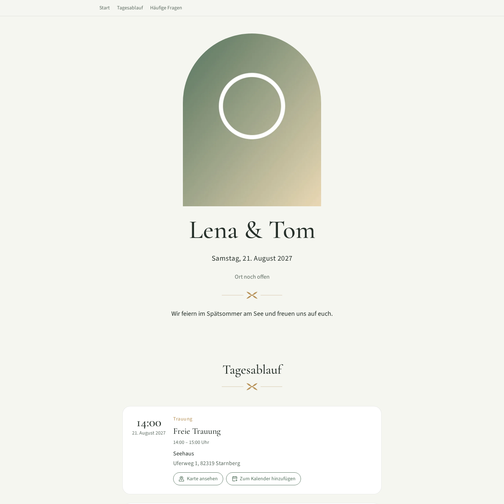

# Traureise

Traureise is a self-hostable, open-source wedding website builder. Couples log in with a link sent by
email, build their wedding website in an editor with a live preview, and share it with their guests by
link or QR code. It is German-first and built so that couples' and guests' data never leaves your
instance.

{ .screenshot }

## What it does

- **Passwordless login.** Enter your email, click the link, done. An account is created on first login.
- **Dashboard** with your websites, a share dialog (QR code to download or copy, link to copy) and
  deletion. Save the Dates, invitations and cards have placeholder tabs for now.
- **Editor with live preview** for the home section (cover photo, date, location, welcome text,
  hashtag, countdown, web address, time zone) and eight sections: Unsere Geschichte, Tagesablauf,
  Anreise, Empfehlungen, Geschenkideen, Hochzeitsgesellschaft, Galerie and Häufige Fragen. Each section can be
  shown, hidden and renamed; items can be added, edited, deleted and moved up or down.
- **Public website** at `/<web-address>`: anchor navigation, OpenStreetMap links, "add to calendar"
  (`.ics`) per event, Open Graph previews, and a `noindex` tag so search engines leave it alone.
- **Themes are data.** A theme is a folder with a JSON manifest, palettes and ornaments. Add a folder,
  restart, done. See [Themes](themes.md).
- **Privacy by design.** No analytics, no CDNs, no fonts or scripts from other servers. Uploaded photos
  are re-encoded, which removes EXIF and GPS data. See [Privacy by design](privacy.md).

<div class="grid" markdown>

{ .screenshot }

{ .screenshot }

</div>

## Get started

Docker with Compose is all you need:

```bash
git clone https://github.com/Traureise/traureise.git
cd traureise
cp .env.example .env        # then set POSTGRES_PASSWORD
docker compose up -d --build
```

Open <http://localhost:3000>. Login emails land in the bundled Mailpit inbox at
<http://localhost:8025>. Continue with the [quick start](getting-started.md).

## License

Traureise is licensed under the GNU Affero General Public License v3.0 or later (AGPL-3.0-or-later): you
may run, change and share it, and if you offer a modified version as a service, you must make your
changes available to its users.
